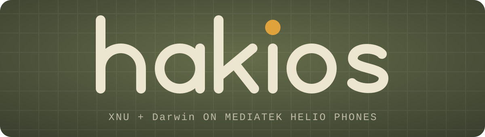
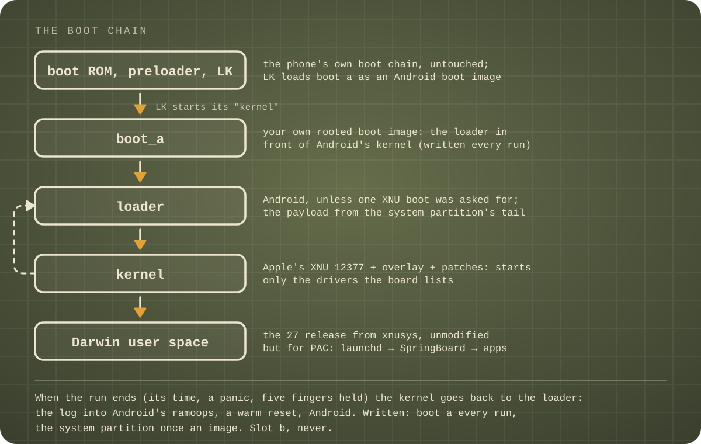

<p align="center">
  
</p>

<p align="center">
  Apple's open-source XNU kernel and the Darwin user space, on phones with MediaTek Helio chips.
</p>

<p align="center">
  <a href="docs/architecture.md">Architecture</a> · <a href="docs/porting.md">Porting</a> · <a href="docs/building.md">Building</a> · <a href="docs/drivers.md">Drivers</a> · <a href="https://github.com/oosexgang/xnu-kernel-mtk-helio/tree/devices">Devices</a> · <a href="CONTRIBUTING.md">Contributing</a>
</p>

<p align="center">
  <a href="https://github.com/oosexgang/xnu-kernel-mtk-helio/actions/workflows/check.yml"></a>
  <a href="docs/README.md"></a>
  <a href="https://github.com/oosexgang/xnu-kernel-mtk-helio/tree/devices"></a>
  <a href="https://t.me/oosexgangdevs"></a>
  <a href="kernel/UPSTREAM"></a>
</p>

<p align="center">
  English | <a href="README.ru.md">Русский</a>
</p>

# HakiOS · MediaTek Helio

HakiOS runs Apple's open-source XNU kernel and a Darwin user space on Android phones with MediaTek
Helio chips. Android stays the phone's system: the loader sits in front of Android's own kernel,
starts XNU once when Android asks for it, and the phone comes back to Android by itself, with the
kernel's log.

> Experimental. Needs an unlocked bootloader and root under Android.
> **Two partitions are written**: `boot_a` (your own rooted boot image with the loader in front of
> its kernel, every run) and a partition of your own for the system image (once an image). Slot `b`
> is never written. Check that the boot ROM's download mode can rewrite `boot_a` **before** the first
> flash: [the way back](docs/porting.md#what-the-phone-must-allow).

This branch is the project itself, for any phone: the kernel, the loader, the user space, the tools,
the description of each supported chip. It names no phone. A phone is a **device package**, a small
directory kept on the [`devices` branch](https://github.com/oosexgang/xnu-kernel-mtk-helio/tree/devices),
and one command brings it into a checkout.

## What is here

- **One kernel for every board.** The board is found at boot; a driver starts only where the board's
  file lists it, and only with its boot argument, so a machine nobody described is never written to.
- **Boards are data.** A phone is one TOML file and its chip another. Addresses, memory ranges, the
  panel, the cell and the boot defaults live there, not in the drivers or the loader. A tool starts
  the phone's file from its Android device tree and says what can be turned on next.
- **Darwin 27.** The 27.2 release's own user space, as its maker ships it but for pointer
  authentication, which this CPU does not have and which is rewritten out of the code. It is built
  from your own IPSW on your machine (`darwin/`).
- **Metal on the Mali-G52.** A native Metal library over the kernel's Mali driver: CoreAnimation's
  shaders go from Apple's AIR to NIR and through Mesa's Bifrost compiler, and the stages the window
  server needs are compiled on the Mac beforehand ([docs/metal-glass.md](docs/metal-glass.md)).
- **Checks that need no phone.** The board files are validated, the drivers run on the host against
  models of the hardware, the loader is compiled for a made-up phone, the generated references are
  kept current, and the kernel sources are verified against Apple's release, on every push.
- **Pinned inputs.** Everything taken from elsewhere is in [`components.toml`](components.toml), at
  an exact version.

## How it boots

<p align="center">
  
</p>

How the pieces fit together: [docs/architecture.md](docs/architecture.md).

## Devices

The phones are device packages, kept apart from the code on the
[`devices` branch](https://github.com/oosexgang/xnu-kernel-mtk-helio/tree/devices): its README lists
them with how far each is, and each package's own README and journal say what works on that phone,
what was verified on it and when, and what is still off. Chip support is shared and lives here, one
file a chip in [`soc/`](soc): MT6768 (Helio G85) so far.

## Quick start

```sh
git clone https://github.com/oosexgang/xnu-kernel-mtk-helio.git
cd xnu-kernel-mtk-helio
make check                        # everything that needs no phone

tools/device.py available         # the phones there are packages for
tools/device.py add x6826b        # bring one in (devices/x6826b)
tools/boards.py status x6826b     # what it has on, what it can turn on next
```

Then build and run: [docs/building.md](docs/building.md). For a phone that has no package yet:
[docs/porting.md](docs/porting.md).

## Start here

| You want to | Read |
| --- | --- |
| Understand how it fits together | [docs/architecture.md](docs/architecture.md) |
| Port it to your phone | [docs/porting.md](docs/porting.md) |
| Build the kernel, the images and run them | [docs/building.md](docs/building.md) |
| Go from a Mac to Darwin 27 on a phone (in Russian) | [docs/darwin27.ru.md](docs/darwin27.ru.md) |
| Know what a driver, a feature or a boot argument does | [docs/drivers.md](docs/drivers.md), [docs/features.md](docs/features.md), [docs/boot-args.md](docs/boot-args.md) |
| Know where Metal on the Mali stands | [docs/metal-glass.md](docs/metal-glass.md) |
| Read how Darwin 27 came up, run by run | [docs/darwin27-boot.md](docs/darwin27-boot.md) |
| Write a driver for a part nobody has one for | [docs/writing-a-driver.md](docs/writing-a-driver.md) |
| Find out what a message in the log means | [docs/troubleshooting.md](docs/troubleshooting.md) |
| Look up a word | [docs/glossary.md](docs/glossary.md) |
| Know how boards and packages are described | [devices/README.md](devices/README.md) |
| Change something and send it back | [CONTRIBUTING.md](CONTRIBUTING.md) |
| Carry over a branch or a patch from an earlier layout | [docs/migrating.md](docs/migrating.md) |
| See what changed | [CHANGELOG.md](CHANGELOG.md) |

## Layout

| Path | Contents |
| --- | --- |
| `devices/` | The board template, and the packages you bring in: each a board file. |
| `soc/` | **One file per chip**: where its blocks are, shared by every board with that chip. |
| `kernel/` | The kernel: Apple's pinned release, the files HakiOS adds (`overlay/`), the changes to Apple's files (`patches/`), and the tools that assemble, check and build it. |
| `loader/` | `mtkloader`: what LK starts in place of a kernel. Built for one board. |
| `darwin/` | What Darwin 27 needs: libraries inserted into a few of its processes, the Metal and Mali builds, the PAC rewriter, the image builders (`mtk27.sh` drives them); `darwin/system/` fetches and chooses the earlier system's files. |
| `userland/` | Our own user-space sources: `init`, the inserted libraries, the Metal device and the native Mali library, the audio plug-in, test programs; the job lists (`jobs/`), our launchd jobs (`launchd/`) and the tools of the user space (`tools/`: the shader front end, Mesa's patches, the stage cache, APFS). |
| `workbench/` | Host tests: the tools, and the kernel's drivers against models of the hardware, with a made-up phone and chip. |
| `tools/` | `boards.py` (board files), `device.py` (packages), `bootargs.py` (the generated reference), lint and the publish check; `run/` (one run on the phone, the loader's probes), `log/` (what a run left, as pictures, sound and numbers). |
| `components.toml` | Everything taken from elsewhere, pinned to an exact version. |
| `docs/` | Documentation. |

## Porting in one paragraph

A phone is described by one board file and its chip by a SoC file. `tools/boards.py new NAME --soc
SOC --dtb fdt.dtb` starts the board file from the phone's Android device tree. The kernel starts a
driver only on a board that lists it, so a new phone begins with nothing but LK's framebuffer and gains
hardware one line at a time; `tools/boards.py status NAME` says what can be turned on next and what
each of the rest still needs ([docs/features.md](docs/features.md)). Where the blocks of the chip are
comes from the SoC file, not from the drivers' code. Parts nobody has a driver for yet (a touch
controller, a camera sensor) need one written, from an example that is built and tested with the rest
([docs/writing-a-driver.md](docs/writing-a-driver.md)). When it works, the package goes to the
`devices` branch. The guide: [docs/porting.md](docs/porting.md).

## What is not in this repository

Nothing of Apple's and nothing of a phone's vendor. XNU is fetched at build time from Apple's
open-source release. The system's files come from Apple's IPSW, on your machine; the SDK is yours to
install. The phone's firmware (touch controller, CONNSYS, sensor hub, camera tables) and its rooted
boot image come off your own phone. No picture of a screen is kept: the documents say in words what
the screen showed. Details: [docs/architecture.md](docs/architecture.md#what-is-not-in-this-repository),
[NOTICE.md](NOTICE.md).

## Where it came from

The port grew out of the working tree of the project's first phone, and out of
[hakios-xnu-kernel](https://github.com/oosexgang/hakios-xnu-kernel), branch `mtk`. For people with a
branch from there: [docs/migrating.md](docs/migrating.md) says where everything went, and
[CHANGELOG.md](CHANGELOG.md) what changed. The Qualcomm side of the project is
[xnu-kernel-qcom](https://github.com/oosexgang/xnu-kernel-qcom); the scripts of `darwin/` and the
shader front end came from there.

## Community

News and progress: [t.me/oosexgangdevs](https://t.me/oosexgangdevs). Questions, bugs and new phones:
the repository's issues and pull requests; [CONTRIBUTING.md](CONTRIBUTING.md) says where a change goes.

## Licences

See [NOTICE.md](NOTICE.md) and the source headers. Apple's files, SDKs, device firmware and built
images are local build inputs and outputs, never repository content; `tools/check-publishable.sh`
looks for them.

## Acknowledgements

- [HakiOS](https://github.com/oosexgang/hakios-xnu-kernel) and [xnu-kernel-qcom](https://github.com/oosexgang/xnu-kernel-qcom)
- [Mesa](https://mesa3d.org/): panfrost and the Bifrost compiler
- [mtkclient](https://github.com/bkerler/mtkclient): the way back through the boot ROM
- Apple's open-source XNU, and the Linux and Android drivers cited in individual source files

Apple, Darwin and Metal are trademarks of Apple Inc. This project is not affiliated with or endorsed
by Apple, MediaTek or Infinix; their names are used only to say what the code works with.
