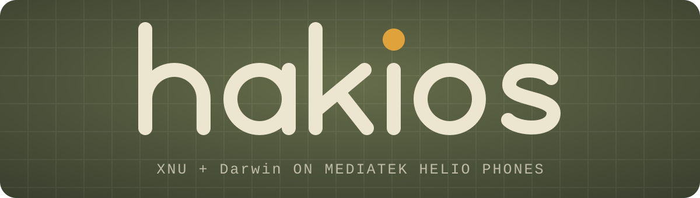
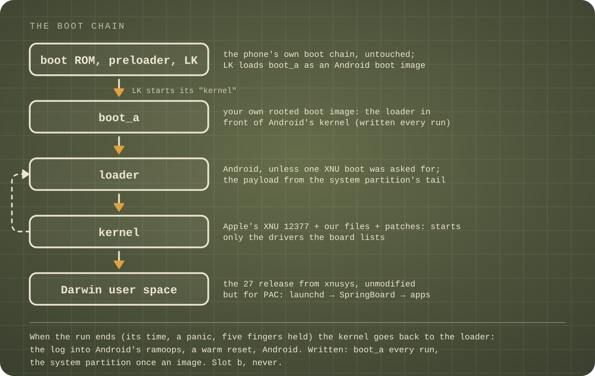

<p align="center">
  
</p>

<p align="center">
  Открытое ядро XNU от Apple и пользовательское окружение Darwin на телефонах с чипами MediaTek Helio.
</p>

<p align="center">
  <a href="Documentation/architecture.md">Архитектура</a> · <a href="Documentation/porting.md">Перенос</a> · <a href="Documentation/building.md">Сборка</a> · <a href="Documentation/drivers.md">Драйверы</a> · <a href="https://github.com/oosexgang/xnu-kernel-mtk-helio/tree/devices">Устройства</a> · <a href="CONTRIBUTING.md">Участие</a>
</p>

<p align="center">
  <a href="https://github.com/oosexgang/xnu-kernel-mtk-helio/actions/workflows/check.yml"></a>
  <a href="Documentation/README.md"></a>
  <a href="https://github.com/oosexgang/xnu-kernel-mtk-helio/tree/devices"></a>
  <a href="https://t.me/oosexgangdevs"></a>
  <a href="kernel/UPSTREAM"></a>
</p>

<p align="center">
  <a href="README.md">English</a> | Русский
</p>

# HakiOS · MediaTek Helio

HakiOS запускает открытое ядро XNU от Apple и пользовательское окружение Darwin на Android-телефонах
с чипами MediaTek Helio. Основной системой телефона остаётся Android: загрузчик стоит перед ядром
Android, один раз запускает XNU по запросу из Android, и телефон сам возвращается в Android вместе с
журналом ядра.

> Экспериментальный проект. Нужны разблокированный загрузчик и root в Android.
> **Записываются два раздела**: `boot_a` (ваш рутованный загрузочный образ, перед ядром Android в нём
> стоит загрузчик; каждый запуск) и отдельный раздел под системный образ (один раз на образ). Слот `b`
> не записывается никогда. **До первой записи** убедитесь, что режим загрузки boot ROM может
> переписать `boot_a`: [путь назад](Documentation/porting.md#what-the-phone-must-allow).

Эта ветка — сам проект, для любого телефона: ядро, загрузчик, пользовательское окружение, инструменты,
описание каждого поддержанного чипа. Ни одного телефона она не называет. Телефон — это **пакет
устройства**, небольшой каталог в [ветке `devices`](https://github.com/oosexgang/xnu-kernel-mtk-helio/tree/devices);
одна команда приносит его в рабочую копию.

## Что здесь есть

- **Одно ядро на все платы.** Плата определяется при загрузке; драйвер стартует только там, где он
  указан в файле платы, и только по своему аргументу загрузки, поэтому в машину, которую никто не
  описал, ничего не пишется.
- **Платы — это данные.** Телефон — один TOML-файл, его чип — другой. Адреса, области памяти, панель,
  аккумулятор и параметры запуска лежат там, а не в драйверах и не в загрузчике. Инструмент начинает
  файл телефона из его Android-дерева устройств и говорит, что можно включить следующим.
- **Darwin 27.** Пользовательское окружение релиза 27.2 в том виде, в каком его выпускает
  производитель, — кроме аутентификации указателей: у этого процессора её нет, и она вычищается из
  кода. Собирается из вашего собственного IPSW на вашей машине (`darwin/`).
- **Metal на Mali-G52.** Собственная библиотека Metal поверх драйвера Mali в ядре: шейдеры CoreAnimation
  переводятся из Apple AIR в NIR и компилируются компилятором Bifrost из Mesa, а стадии, нужные
  оконному серверу, заранее собираются на Mac ([Documentation/metal-glass.md](Documentation/metal-glass.md)).
- **Проверки без телефона.** Файлы плат проверяются, драйверы работают на компьютере против моделей
  железа, загрузчик компилируется для выдуманного телефона, генерируемые справочники держатся в
  актуальном виде, исходники ядра сверяются с релизом Apple — на каждый push.
- **Закреплённые входы.** Всё внешнее перечислено в [`components.toml`](components.toml) с точной
  версией.

## Как это загружается

<p align="center">
  
</p>

Как части связаны между собой: [Documentation/architecture.md](Documentation/architecture.md).

## Устройства

Телефоны — это пакеты устройств, они хранятся отдельно от кода в
[ветке `devices`](https://github.com/oosexgang/xnu-kernel-mtk-helio/tree/devices): её README
перечисляет их и говорит, насколько продвинулся каждый, а README и журнал каждого пакета — что
работает на этом телефоне, что и когда на нём проверено и что ещё выключено. Поддержка чипов общая и
лежит здесь, по файлу на чип в [`arch/arm64/boot/dts/mediatek/`](arch/arm64/boot/dts/mediatek): пока MT6768 (Helio G85).

## Быстрый старт

```sh
git clone https://github.com/oosexgang/xnu-kernel-mtk-helio.git
cd xnu-kernel-mtk-helio
make check                        # всё, что не требует телефона

tools/device.py available         # для каких телефонов есть пакеты
tools/device.py add x6826b        # принести один (arch/arm64/boot/dts/x6826b)
tools/boards.py status x6826b     # что у него включено и что можно включить следующим
```

Дальше — сборка и запуск: [Documentation/building.md](Documentation/building.md), по-русски и по шагам:
[Documentation/darwin27.ru.md](Documentation/darwin27.ru.md). Для телефона, у которого ещё нет пакета:
[Documentation/porting.md](Documentation/porting.md).

## С чего начать

| Вы хотите | Читайте |
| --- | --- |
| Понять, как всё устроено | [Documentation/architecture.md](Documentation/architecture.md) |
| Перенести на свой телефон | [Documentation/porting.md](Documentation/porting.md) |
| Собрать ядро и образы и запустить их | [Documentation/building.md](Documentation/building.md) |
| Пройти путь от Mac до Darwin 27 на телефоне, по-русски | [Documentation/darwin27.ru.md](Documentation/darwin27.ru.md); коротко — [Documentation/quickstart.ru.md](Documentation/quickstart.ru.md) |
| Провести день с телефоном: прогоны по порядку и признаки успеха | [Documentation/phone-test.ru.md](Documentation/phone-test.ru.md) |
| Узнать, что нового | [Documentation/whats-new.ru.md](Documentation/whats-new.ru.md) |
| Узнать, что делает драйвер, функция платы или аргумент загрузки | [Documentation/drivers.md](Documentation/drivers.md), [Documentation/features.md](Documentation/features.md), [Documentation/boot-args.md](Documentation/boot-args.md) |
| Узнать, где сейчас Metal на Mali | [Documentation/metal-glass.md](Documentation/metal-glass.md) |
| Прочитать, как поднимался Darwin 27, запуск за запуском | [Documentation/darwin27-boot.md](Documentation/darwin27-boot.md) |
| Написать драйвер для детали, у которой его нет | [Documentation/writing-a-driver.md](Documentation/writing-a-driver.md) |
| Понять, что значит сообщение в журнале | [Documentation/troubleshooting.md](Documentation/troubleshooting.md) |
| Найти слово | [Documentation/glossary.md](Documentation/glossary.md) |
| Узнать, как описываются платы и пакеты | [arch/arm64/boot/dts/README.md](arch/arm64/boot/dts/README.md) |
| Что-то изменить и прислать | [CONTRIBUTING.md](CONTRIBUTING.md) |
| Перенести ветку или патч из прежней раскладки | [Documentation/migrating.md](Documentation/migrating.md) |
| Посмотреть, что изменилось | [CHANGELOG.md](CHANGELOG.md) |

## Раскладка

Как у Linux; каждый каталог и то, какому каталогу дерева XNU соответствует наш каталог ядра, —
в [Documentation/layout.md](Documentation/layout.md).

| Путь | Что там |
| --- | --- |
| `arch/arm64/kernel/`, `arch/arm64/include/` | Платформа: GICv3, остальные ядра через PSCI, возврат в загрузчик с журналом, профилировщик; заголовок машины. |
| `arch/arm64/boot/` | `mtkloader`: то, что LK запускает вместо ядра, собирается под одну плату; сборка нагрузки и загрузочного образа. |
| `arch/arm64/boot/dts/` | Шаблон платы и пакеты, которые вы приносите (в каждом файл платы); `mediatek/`: **по файлу на чип**, где лежат его блоки, общий для всех плат с этим чипом. |
| `arch/arm64/configs/` | Аргументы загрузки каждого вида прогона (`*_defconfig`: `make defconfigs`) и конфигурация сборки ядра (`xnu/`). |
| `drivers/` | Драйверы: `board/` (`mtk_*` для блоков MediaTek, `hakios_*` для того, что одинаково на любом телефоне) и `iokit/` (`HakiosMali`, замены закрытых расширений ядра Apple). |
| `fs/`, `crypto/`, `security/`, `include/` | APFS и файловая система в памяти; криптография ядра; политика подписи кода; заголовки, общие у ядра с пользовательским окружением. |
| `kernel/` | Закреплённый релиз Apple, изменения файлов Apple (`patches/`) и инструменты, которые собирают, проверяют и компилируют дерево. |
| `init/`, `lib/` | Первые программы Darwin (`stage0`, `init`) и их маленькая библиотека C. |
| `darwin/` | Что нужно Darwin 27: библиотеки, встраиваемые в несколько его процессов, сборка Metal и Mali, переписчик PAC, сборщики образов (их ведёт `mtk27.sh`); `darwin/system/` скачивает и отбирает файлы прежней системы. |
| `userland/` | Наши исходники пользовательского окружения: встраиваемые библиотеки, устройство Metal и нативная библиотека Mali, аудио-плагин, инструменты прогона и тестовые программы; списки заданий (`jobs/`), наши задания launchd (`launchd/`) и инструменты окружения (`tools/`: фронтенд шейдеров, патчи Mesa, кэш стадий, APFS). |
| `workbench/` | Тесты на компьютере: инструменты и драйверы ядра против моделей железа, с выдуманными телефоном и чипом. |
| `tools/` | `boards.py` (файлы плат), `device.py` (пакеты), `defconfig.py` (аргументы прогонов), `bootargs.py` (генерируемый справочник), проверка стиля и проверка публикации; `run/` (один запуск на телефоне, пробы загрузчика), `log/` (что оставил запуск: картинки, звук, числа). |
| `Documentation/` | Документация ([оглавление](Documentation/README.md)). |
| `MAINTAINERS`, `components.toml` | Файлы, тесты и документы каждой части; всё внешнее, закреплённое на точной версии. |

## Перенос в одном абзаце

Телефон описывается одним файлом платы, его чип — файлом SoC. `tools/boards.py new NAME --soc SOC
--dtb fdt.dtb` начинает файл платы из Android-дерева устройств телефона. Ядро запускает драйвер только
на плате, которая его указала, поэтому новый телефон начинает с одного framebuffer'а LK и получает
железо по строчке; `tools/boards.py status NAME` говорит, что можно включить следующим и чего не
хватает остальному ([Documentation/features.md](Documentation/features.md)). Где лежат блоки чипа, говорит файл SoC, а
не код драйверов. Для деталей, у которых драйвера ещё нет (контроллер касаний, сенсор камеры), его
нужно написать — с примера, который собирается и тестируется вместе со всем остальным
([Documentation/writing-a-driver.md](Documentation/writing-a-driver.md)). Когда всё заработает, пакет уходит в ветку
`devices`. Руководство: [Documentation/porting.md](Documentation/porting.md).

## Чего в репозитории нет

Ничего от Apple и ничего от производителя телефона. XNU скачивается при сборке из открытого релиза
Apple. Файлы системы берутся из IPSW Apple на вашей машине; SDK ставите сами. Прошивки телефона
(контроллер касаний, CONNSYS, сенсорный хаб, таблицы камеры) и его рутованный загрузочный образ
снимаются с вашего же телефона. Снимков экрана здесь нет: документы словами говорят, что показал
экран. Подробно: [Documentation/architecture.md](Documentation/architecture.md#what-is-not-in-this-repository),
[NOTICE.md](NOTICE.md).

## Откуда это

Порт вырос из рабочего дерева первого телефона проекта и ветки `mtk` репозитория
[hakios-xnu-kernel](https://github.com/oosexgang/hakios-xnu-kernel). Тем, у кого есть ветки оттуда:
[Documentation/migrating.md](Documentation/migrating.md) — что куда переехало, [CHANGELOG.md](CHANGELOG.md) — что
изменилось. Qualcomm-часть проекта — [xnu-kernel-qcom](https://github.com/oosexgang/xnu-kernel-qcom);
оттуда пришли скрипты `darwin/` и фронтенд шейдеров.

## Сообщество

Новости и ход работы: [t.me/oosexgangdevs](https://t.me/oosexgangdevs). Вопросы, ошибки и новые
телефоны — в issues и pull request'ах репозитория; [CONTRIBUTING.md](CONTRIBUTING.md) говорит, куда что
относится.

## Лицензии

См. [NOTICE.md](NOTICE.md) и заголовки исходников. Файлы Apple, SDK, прошивки устройств и собранные
образы — это локальные входы и выходы сборки, а не содержимое репозитория; их ищет
`tools/check-publishable.sh`.

## Благодарности

- [HakiOS](https://github.com/oosexgang/hakios-xnu-kernel) и [xnu-kernel-qcom](https://github.com/oosexgang/xnu-kernel-qcom)
- [Mesa](https://mesa3d.org/): panfrost и компилятор Bifrost
- [mtkclient](https://github.com/bkerler/mtkclient): путь назад через boot ROM
- открытый XNU от Apple и драйверы Linux и Android, на которые ссылаются исходники

Apple, Darwin и Metal — товарные знаки Apple Inc. Проект не связан с Apple, MediaTek или Infinix и не
одобрен ими; их названия используются только чтобы сказать, с чем работает код.
