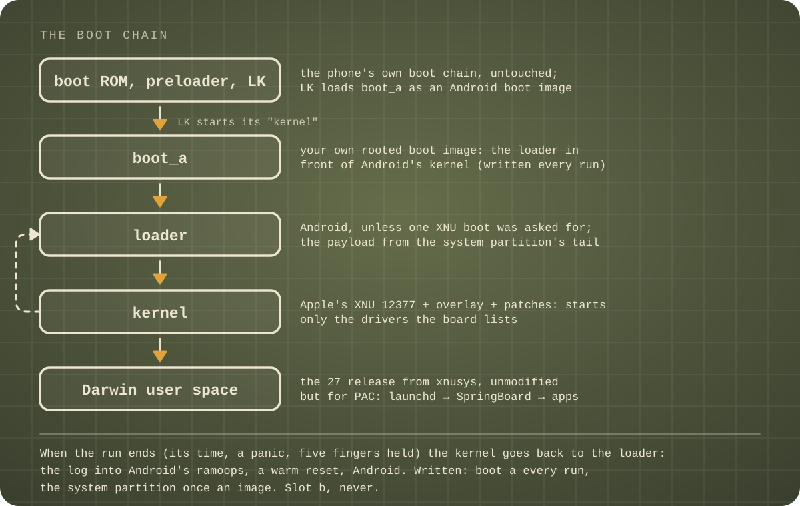
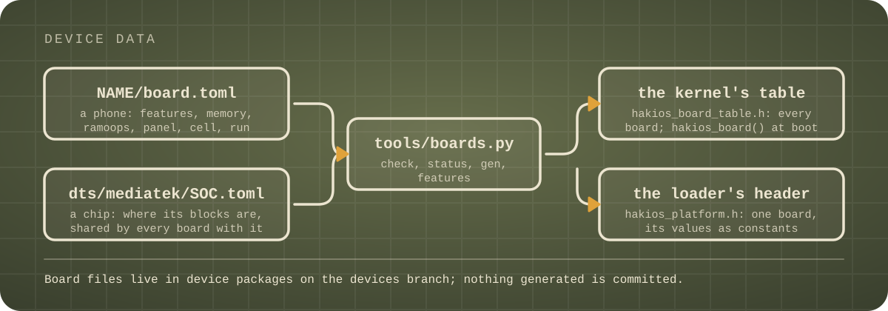

# Architecture

How the pieces fit together, and where each one lives in the repository. Read this before changing
anything; [porting.md](porting.md) is the step-by-step guide for a new device, and the words are in
[glossary.md](glossary.md).

## The boot chain

<p align="center">
  
</p>

```
boot ROM -> preloader -> LK (the phone's own, untouched)
   LK loads boot_a as an Android boot image and starts its "kernel" as a Linux arm64 Image:
   MMU and caches off, x0 = LK's device tree
      the "kernel" is gzip of:  mtkloader | padding | Android's own Image
         loader (arch/arm64/boot/): Android, unless one XNU boot was asked for
           - built for one board: every address is that board's (hakios_platform.h)
           - reads the payload (the kernel and the small image) from the last 96 MiB of the system
             partition, checks its sum
           - builds the Apple-format device tree and boot_args, names the board in /chosen/darwin-board
           - gives the kernel LK's framebuffer; uploads the touch controller's firmware on the way
           - a watcher on a spare core takes a snapshot and resets the board if the kernel never returns
              kernel (kernel/: Apple's xnu-12377 + overlay + patches)
                - looks its board up in the generated table (hakios_board())
                - starts only the drivers the board lists and the boot arguments ask for
                - the root is the system image on the eMMC (xnusys); the small image is md1 on /hakios;
                  /private/var lives in RAM
                   user space: stage0 -> init -> launchd -> backboardd -> SpringBoard -> apps
                     - small libraries of ours are inserted into a few processes (kern.exec_inject)
         ... the run ends (its time, a panic, five fingers held) -> back into the loader
             -> the log into Android's ramoops zones -> warm reset -> Android, which shows it in /sys/fs/pstore
```

**The default is Android.** XNU starts only when the loader finds the request `HAKIOS:BOOT-XNU` in
ramoops' pmsg zone, written from Android by `tools/run/boot-xnu.sh`, and takes it away: the boot after
XNU is Android again. A kernel that hangs costs a power cycle.

What this port does that a `fastboot boot` port does not, and what it costs: it **writes `boot_a`**
(every run: the loader is built with the run's flags and packed into your own rooted boot image) and
**a partition for the system image** (once an image; the payload goes into its last 96 MiB every run).
It needs root under Android for three things: the request through `/dev/pmsg0`, the log out of
`/sys/fs/pstore`, and writing the partition. The way back from a broken `boot_a` is the boot ROM's
download mode (mtkclient); [porting.md](porting.md) says how to check it first.

## Three layers, three kinds of change

| Layer | Where | Changes when |
| --- | --- | --- |
| **Device data** | A device package per phone (`NAME/board.toml`, on the `devices` branch), `arch/arm64/boot/dts/mediatek/SOC.toml` on the main branch | A new phone, or a new SoC. No code. |
| **Drivers for parts** | `drivers/board/`, `drivers/iokit/`, the loader's part headers | A phone has a part nobody wrote a driver for yet (a touch controller, a camera sensor). |
| **The port itself** | `kernel/patches/`, the rest of `kernel/overlay/`, `arch/arm64/boot/`, `userland/`, `darwin/` | Apple's kernel or the system changes, or the port learns something new. Same for every device. |

The aim is that a new phone on a known SoC is a change to the first row only, and a new SoC adds one
file to it. Where that is not yet true, [drivers.md](drivers.md) says so driver by driver.

## Device data

<p align="center">
  
</p>

- The repository describes no phone. `arch/arm64/boot/dts/` on the main branch has a template
  (`arch/arm64/boot/dts/_template/`).
- A phone is a **device package**: a directory `NAME/` with its `board.toml`, its README and its
  journal. Packages are kept on the `devices` branch. `tools/device.py add NAME` copies one into
  `arch/arm64/boot/dts/NAME/` of a checkout, which git ignores there.
- A **board file** says what the device has: its SoC, the drivers it may start (`features`,
  [features.md](features.md)), the memory the loader may use (`[loader]`), Android's ramoops zones
  (`[ramoops]`), the panel and LK's framebuffer (`[display]`), the cell (`[battery]`), CONNSYS's
  reserved memory (`[connsys]`), its default run (`[boot]`).
- A **SoC file** says where the blocks of the chip are: the interrupt controller and the cores
  (`[platform]`), every peripheral block a driver maps (`[blocks]`), the big cluster's PLL
  (`[cpufreq]`).
- The generated files are not committed. `kernel/build.sh` and `arch/arm64/boot/build.sh` run
  `tools/boards.py gen` themselves.
- **The kernel** finds its row by `/chosen/darwin-board`. A driver asks
  `hakios_board_wants(HAKIOS_HAS_…)` before it starts and reads addresses from `hakios_board()`.
  A board that is not in the table has no feature: nothing of a phone is touched on a machine nobody
  described.
- **The loader** is not one binary for every board, and cannot be: LK starts it at an address that is
  the phone's, and it travels inside that phone's own boot image. It is compiled for one board, with
  that board's values as constants, and its part drivers (the touch firmware upload, the CONNSYS
  report) are compiled in only for a board that lists the feature.

Details and every key: [arch/arm64/boot/dts/README.md](../arch/arm64/boot/dts/README.md), `arch/arm64/boot/dts/_template/`.

## The kernel

| Path | Contents |
| --- | --- |
| `kernel/UPSTREAM` | The Apple release, pinned by commit: xnu-12377.121.6, the 27 release's. |
| `kernel/overlay/` | The files added, as ordinary sources at their place in the XNU tree. |
| `kernel/patches/` | The changes to Apple's own files, as patches by topic (`patches/series`). |
| `kernel/assemble.sh`, `export.sh`, `verify.sh` | Make the tree that is compiled; take work back; check the round trip. |
| `kernel/build.sh`, `env.sh`, `deps/` | The build, on macOS (LLVM 19.1.7, mig 138, the iig headers of macOS 26.5's SDK). |

What the overlay provides, in the order a boot meets it:

1. **Platform** (`osfmk/arm64/`): GICv3 interrupts, PSCI for the other cores, the return to the
   loader with the log.
2. **Stand-ins for Apple's closed kernel extensions** (`iokit/Kernel/`, `libkern/amfi/`,
   `osfmk/minicrypto/`): the platform expert, IOSurface, IOMobileFramebuffer, AppleKeyStore,
   FairPlay's client, the network stack's registry side, code-signing policy, crypto.
3. **File systems** (`bsd/miscfs/apfs/`, `ramfs/`): an APFS implementation that reads the system
   image, and the RAM file system for `/private/var`.
4. **Drivers** (`bsd/dev/`): `mtk_*` for MediaTek's blocks (eMMC, the PMIC's keys and gauge, the
   clocks, Mali, CONNSYS's Wi-Fi and Bluetooth, the sensor hub, the camera path), `hakios_*` for what
   is the same on any phone (touch input, the network interface, the Wi-Fi station's side, audio, the
   board table). `HakiosMali.cpp` gives user space the GPU. Each does nothing until its boot argument
   asks.

More: [kernel/README.md](../kernel/README.md), [kernel/patches/README.md](../kernel/patches/README.md),
[drivers.md](drivers.md), [boot-args.md](boot-args.md).

## The loader

`arch/arm64/boot/mtkloader.c` is one program: LK's hand-over, the payload ("XNUP": kernel + small image), the
device tree it builds for XNU, the log's way into ramoops, the watcher. `msdc.h` reads the eMMC as LK
left it; `mtkdbg.h` is the screen and ramoops output; `mtkspi.h` and `tcm.h` are the touch
controller's bus and protocol; `mtkpwrap.h`, `mtkmali.h`, `mtkcam.h` and `mtkconnsys.h` are probes
that report and return to Android. It runs with the MMU off, so all memory is device memory: no SIMD,
no unaligned access, no compiler builtins. More: [arch/arm64/boot/README.md](../arch/arm64/boot/README.md).

## User space

The system's own programs are used as their maker ships them, but for the pointer authentication of
their arm64e code, which this CPU does not have: `darwin/tools/pacstrip` rewrites it into plain
instructions in the shared cache and every Mach-O of the image. What is ours:

| Path | Contents |
| --- | --- |
| `init/stage0.c`, `init.c` (with `lib/libmini/`) | `/sbin/launchd` of the system image is stage0: it mounts the small image on `/hakios` and runs our init (mounts, checks, the data volume, overlays, the libraries to insert), which hands process 1 to the system's launchd (`/sbin/launchd.system`). |
| `userland/src/inject*.c` | Libraries inserted into single processes by the kernel (`kern.exec_inject`). |
| `userland/src/hakiosmetal.m`, `metal/`, `mali/` | The Metal device, and the native library that draws its frames on the Mali ([metal-glass.md](metal-glass.md)). |
| `userland/src/audio_plugin.c` | The audio output device. |
| `userland/jobs/`, `launchd/` | What a run does (the job lists, run by our launchd job) and our launchd jobs. |
| `darwin/` | The 27 release: the same sources built for its arm64e processes, the two images ([darwin/README.md](../darwin/README.md)). |
| `userland/build.sh`, `darwin/system/` | The earlier system (20F66): its files fetched, its images built; its small root is where the 27 release's small image starts. |

The system image is written once into the partition; the small image travels with the kernel in the
payload. A launchd job of the system reaches launchd only from the system volume, so a change of jobs
used to need a new system image; with `JOBCACHE=1` the small image carries launchd's job cache and
`init` binds it over the system's.

## What is not in this repository

Being honest about this is part of the architecture: these are the inputs a build or a boot needs
from elsewhere. Everything that is fetched is pinned, listed in one place: `components.toml`
(`tools/components.py` prints it, and the lint checks it against the scripts that fetch).

| What | Why not here | Where it comes from |
| --- | --- | --- |
| Apple's XNU release | It is Apple's; only the pin is kept. | `kernel/assemble.sh` fetches it. |
| The system's files | Apple's files are never redistributed. | The 27 release's IPSW, unpacked on your machine; the earlier system's by `darwin/system/fetch.sh`, from Apple's server. |
| The SDK | Apple's. | `iPhoneOS16.5.sdk` of github.com/theos/sdks, into `$THEOS/sdks`; the macOS 26.5 SDK's iig headers, fetched by `kernel/deps/setup.sh`. |
| The phone's firmware (touch, CONNSYS, sensor hub) and camera tables | The vendor's; taken from the same phone it runs on. | `adb pull` from its Android; the package's journal says which files. |
| The rooted boot image | Your phone's own. | `backup/boot_a_magisk.img`. |
| The loader's font | A rendering of a system font. | `arch/arm64/boot/build.sh` makes it on macOS; elsewhere the loader's text on the panel is blank. |

## Not carried over from the working tree

The UEFI loader and the Mu-Silicium port, the QEMU scripts, the first `fastboot boot` image scripts
and everything of the Qualcomm phone: [migrating.md](migrating.md) lists them.
